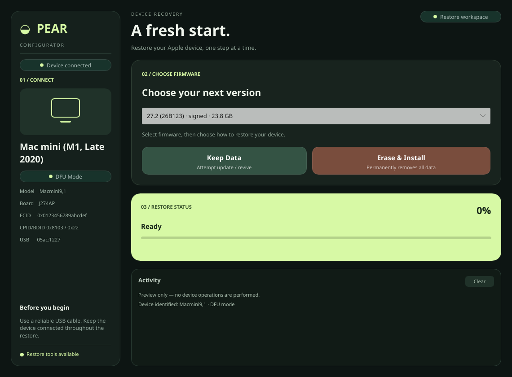
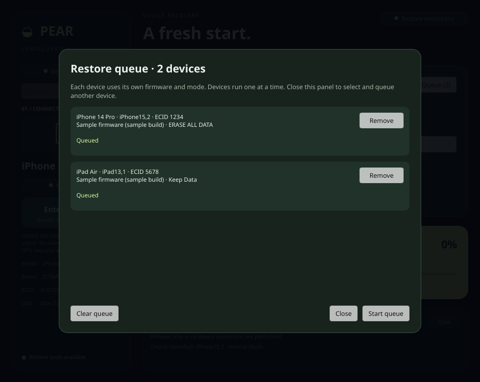

<div align="center">

# PEAR Configurator

**A native Linux workspace for Apple device recovery.**

Identify devices in DFU or recovery mode, select firmware, and follow the restore from one interface.

[](https://github.com/denizomer10/pear-configurator/releases/latest)
[](LICENSE)


[**Download**](https://github.com/denizomer10/pear-configurator/releases/latest) · [Getting started](#getting-started) · [Build from source](#build-from-source) · [Report an issue](https://github.com/denizomer10/pear-configurator/issues)

</div>



<p align="center"><sub>The native restore workspace, rendered with illustrative device and firmware data. This preview does not perform a restore.</sub></p>

## Overview

PEAR Configurator brings device discovery, firmware downloads, and `idevicerestore` into a native desktop application built with Rust and [Slint](https://slint.dev). It runs on Linux with Wayland or X11.

- **Device identification** — detect DFU/recovery devices and resolve model, board, and chip information.
- **Firmware selection** — retrieve available versions and signing status from [ipsw.me](https://ipsw.me).
- **Resumable downloads** — download IPSW files with SHA-256 verification when a checksum is available.
- **Restore visibility** — follow progress and inspect tool diagnostics in the Activity panel.
- **USB access setup** — install the required udev rule through a one-time administrator prompt.

The identification database covers iPhone, iPad, iPod, Apple TV, and Apple Silicon Mac models. Restore compatibility depends on the device, firmware signing status, and bundled Apple tools. Physical DFU restoration has not yet been verified for this release.

### New in v0.2.4

- A device selector lists all connected devices with individual mode and identity information.
- A restore queue stores separate firmware and erase/update choices for each device. It processes devices sequentially, targets every restore by ECID, and records individual results. Cancellation skips the remaining entries.
- Normal-mode iPhone/iPad detection with **Normal Mode**, **Recovery Mode**, and **DFU Mode** labels.
- **Enter Recovery** requests a restart of the selected normal-mode device and waits for Recovery Mode to appear. It does not start a restore or erase.
- Direct software entry into DFU is not provided; DFU requires the physical button sequence for the device.

To restore several devices, enable **Queue for multiple devices**, select a device and firmware, then choose **Queue Erase** or **Queue Keep Data**. Close the queue panel, repeat for the other devices, then open **Queue → Start queue**. Review the complete target list before confirming. Devices must already be in DFU or Recovery Mode; use **Enter Recovery** individually for normal-mode devices first. Failed entries do not stop other queued devices, and disconnected targets are never replaced with another connected device. Queue contents are kept in memory for the current app session.



*Queue preview with illustrative device identities and firmware; no restore is performed.*

Normal-mode identification uses `ideviceinfo`; the recovery button uses `ideviceenterrecovery`. Both are included by the updated AppImage build script. The host must run `usbmuxd`; unlocking the device and accepting Trust may be required. These controls are included in the v0.2.4 package.

## Getting started

### 1. Download and launch

Download the AppImage and checksum file from [GitHub Releases](https://github.com/denizomer10/pear-configurator/releases/latest), then run:

```sh
sha256sum -c SHA256SUMS-v0.2.4.txt
chmod +x PEAR-Configurator-v0.2.4-x86_64.AppImage
./PEAR-Configurator-v0.2.4-x86_64.AppImage
```

**Current release: v0.2.4**

| Requirement | Details |
| --- | --- |
| Architecture | x86_64; an ARM64 package is not included in v0.2.4 |
| Linux runtime | glibc 2.43 or newer; this package was built locally on Ubuntu 26.04 |
| Desktop | Wayland or X11 |
| USB setup | Administrator authorization to install the access rule |
| Connection | USB cable suitable for your device; internet access for firmware lookup and downloads |

The AppImage includes the application, `idevicerestore`, `irecovery`, and bundled shared libraries. It still relies on a compatible host glibc and desktop environment. The restore tools are reused from the v0.2.0 release; normal-mode utilities are libimobiledevice 1.4.0.

If your system cannot mount AppImages through FUSE, use:

```sh
APPIMAGE_EXTRACT_AND_RUN=1 ./PEAR-Configurator-v0.2.4-x86_64.AppImage
```

### 2. Enable USB access

On first launch, complete the USB access setup dialog. PEAR installs `/etc/udev/rules.d/70-pear-apple.rules` and reloads udev. Reconnect your device if access is not applied immediately.

### 3. Restore your device

1. Connect the device and put it into **DFU** or **recovery** mode.
2. Check the detected model and mode in the device sidebar.
3. Select the intended firmware version; check its signing status.
4. Choose a restore mode and follow its progress in **Restore Status** and **Activity**.

| Restore mode | Behavior |
| --- | --- |
| **Keep Data** | Attempts an update/revive without requesting an erase. Data preservation depends on the device and restore outcome. |
| **Erase & Install** | Performs an erase restore. Requires confirmation and permanently removes device data. |

> **Back up important data before restoring.** Erase & Install cannot be undone. Keep Data is not a backup or a guarantee of data preservation.

## Troubleshooting

### Device is visible in DFU, but restore cannot discover its mode

USB discovery through sysfs can identify a device even when the restore tool cannot open it. Restart the updated application, complete USB access setup, and reconnect the cable.

Older releases installed `99-pear-apple.rules`, which ran after systemd's seat access rules. The updated application installs `70-pear-apple.rules` before `73-seat-late.rules`. Device queries also pause during restore to avoid competing USB access.

Review **Activity** for output from both restore streams. Logs are stored in `~/.pear/logs`.

### AppImage reports a missing GLIBC version

The v0.2.4 binary requires glibc 2.43 or newer. On an older distribution, build from source on that system rather than replacing its system glibc.

### Window does not open

Try selecting the software renderer:

```sh
SLINT_BACKEND=winit-software ./PEAR-Configurator-v0.2.4-x86_64.AppImage
```

For bug reports, include your Linux distribution, app version, device model/mode, and relevant Activity output. Remove device identifiers and other personal information before sharing logs.

## Build from source

Install a current stable Rust toolchain. On Ubuntu/Debian, install the GUI build dependencies:

```sh
sudo apt-get install -y build-essential pkg-config libfontconfig1-dev libfreetype-dev
cargo build --release --locked
./target/release/pear-configurator
```

A source build also needs `idevicerestore` and `irecovery` for restore operations. To build the Apple toolchain into `~/.pear/toolchain`:

```sh
bash scripts/install-toolchain.sh --deps
```

The `--deps` option uses apt and asks for administrator authorization. With the dependencies already installed, run the script without that option for an unprivileged toolchain build.

### Build an AppImage locally

```sh
bash scripts/build-appimage.sh
```

The script downloads `linuxdeploy` and `appimagetool`, builds the release binary, and bundles the installed Apple toolchain. Packaging fails if any of `idevicerestore`, `irecovery`, `ideviceinfo`, or `ideviceenterrecovery` is missing.

The build script outputs `dist/PEAR-Configurator-x86_64.AppImage` on x86_64, or `dist/PEAR-Configurator-aarch64.AppImage` when built natively on ARM64. The host environment determines the resulting runtime requirements.

Releases are built locally and uploaded to GitHub Releases. The optional GitHub Actions workflow runs only when manually dispatched.

### Development checks

```sh
cargo test --locked
cargo run --example preview
```

The preview renders the actual Slint interface with sample data, without accessing a device. It writes default and compact PPM screenshots to `/tmp/pear-preview-*.ppm`.

### Command-line utilities

| Option | Purpose |
| --- | --- |
| `--version` | Print the application version without opening the GUI |
| `--selftest` | Check device detection, identification, and firmware lookup without restoring |
| `--download` | Download and verify the first firmware in the current device's sorted list without restoring |

## Data and configuration

| Content | Default location |
| --- | --- |
| Apple toolchain | `~/.pear/toolchain` |
| Downloaded firmware | `~/.pear/ipsw` |
| Cache and device database | `~/.pear/cache`, `~/.pear/data` |
| Restore logs | `~/.pear/logs` |

| Environment variable | Purpose |
| --- | --- |
| `PEAR_HOME` | Override the application's base data directory |
| `PEAR_DOWNLOAD_DIR` | Override the firmware download directory |
| `PEAR_IDEVICERESTORE` | Use a specific `idevicerestore` executable |
| `PEAR_IRECOVERY` | Use a specific `irecovery` executable |
| `PEAR_IDEVICEINFO` | Use a specific `ideviceinfo` executable |
| `PEAR_IDEVICEENTERRECOVERY` | Use a specific `ideviceenterrecovery` executable |

## Acknowledgments

Built on the work of the [libimobiledevice project](https://libimobiledevice.org/), including [idevicerestore](https://github.com/libimobiledevice/idevicerestore) and [libirecovery](https://github.com/libimobiledevice/libirecovery). Firmware metadata is provided by [ipsw.me](https://ipsw.me). The desktop interface uses [Slint](https://slint.dev).

## License

PEAR Configurator is available under the [MIT License](LICENSE). Bundled third-party components retain their respective licenses.
